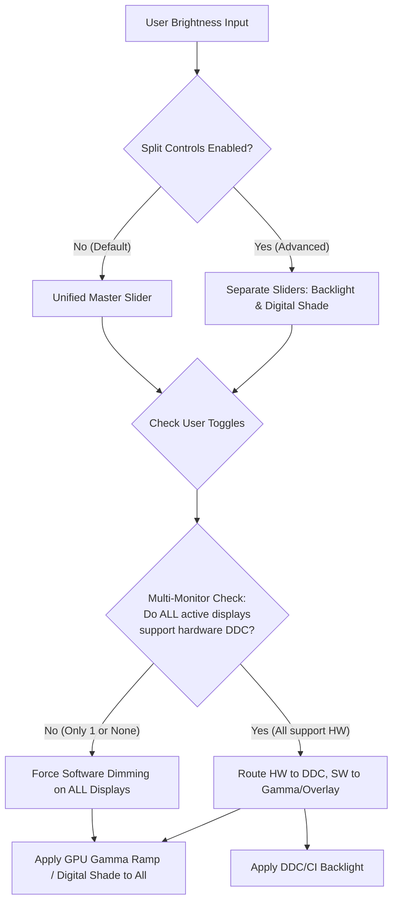

# Dual Hardware & Software Brightness Control Architecture Plan

**Historical proposal:** The implemented contract is in [`system.md`](../../system.md) and
[`spec/README.md`](../../spec/README.md). The review superseded the mandatory shortcut gate,
unconditional hardware resets and mixed-display all-or-nothing rule below: software has a
50% default floor, owned hardware is released once, and macOS/Linux retain hardware control
on capable displays. See [`fable-review-verification.md`](../fable-review-verification.md).

This document specifies the technical design, cross-platform behavioral contract, and step-by-step implementation plan for adding dual hardware/software brightness controls to Moonglow across macOS, Windows, and Linux.

---

## 1. System Overview & Core Principles

Moonglow transitions from an implicit hardware-or-fallback brightness model to an explicit **Dual Control System (Pattern A: Unified by Default, Split in Advanced)**.



### Core Requirements
1. **Pattern A UX (Unified by Default, Split in Advanced):**
   - **Default View:** Single unified master slider (1–100%).
   - **Midpoint Transition Indicator (When both HW & SW are enabled):**
     - The unified slider displays a visible **midpoint tick mark / notch at 50%**.
     - **50%–100% (Hardware Zone):** Backlight dims from 100% down to monitor's physical floor; software digital shade remains at 100% (no contrast loss).
     - **At 50% (Handoff Midpoint):** Visual notch on the slider track indicating transition. Hardware backlight is at minimum floor; software digital shade is at 100%.
     - **1%–50% (Software Digital Shade Zone):** Hardware backlight remains pinned at minimum; software gamma / overlay dims from 100% down to 1% for sub-zero dark-room viewing.
     - *(If only one engine is enabled, the slider spans 1–100% for that single engine without the 50% midpoint mark).*
   - **Advanced View:** Expandable panel revealing two dedicated sliders:
     - **Hardware Backlight** (1–100%): physical panel backlight / DDC/CI.
     - **Digital Shade** (1–100%): GPU gamma table / software dimming.
2. **Independent Engine Toggles:**
   - User can independently toggle:
     - `hardwareBrightnessEnabled` (default: `true`)
     - `softwareBrightnessEnabled` (default: `true`)
   - **Both Enabled (Default):** Unified master slider automatically drives hardware down to minimum, then engages software digital shade. In split mode, both sliders are fully adjustable.
   - **Hardware Only Enabled:** Master slider adjusts only the physical backlight (clamped to hardware minimum). Software digital shade stays locked at 100%.
   - **Software Only Enabled:** Backlight is left unmanaged (or at 100%), and dimming is applied solely via GPU gamma ramp / software overlay.
   - **Both Disabled:** Brightness controls are disabled/hidden, preserving system defaults without interference.
3. **Multi-Monitor All-or-Nothing Fallback:**
   - When controlling multiple connected displays synchronously: if **any** active display lacks hardware DDC/CI support (e.g., Monitor A supports DDC, but Monitor B does not):
     - **Both monitors fall back to software dimming.**
     - Physical backlights on DDC-capable monitors are reset to 100% (or unmanaged) to ensure uniform brightness, contrast, and response times across all screens.

---

## 2. Shared Specification & Contract (`spec/`)

All platforms share the configuration schema and golden test vectors in `spec/`.

### 2.1 Settings Schema (`spec/settings.schema.json`)

Add the following properties to `spec/settings.schema.json`:

```json
{
  "hardwareBrightnessEnabled": {
    "type": "boolean",
    "default": true,
    "description": "Whether Moonglow is permitted to send DDC/CI hardware backlight commands."
  },
  "softwareBrightnessEnabled": {
    "type": "boolean",
    "default": true,
    "description": "Whether Moonglow is permitted to use GPU gamma ramps or digital shading."
  },
  "splitBrightnessControls": {
    "type": "boolean",
    "default": false,
    "description": "When true, UI displays separate Hardware Backlight and Digital Shade sliders."
  },
  "manualHardwareBrightness": {
    "type": "integer",
    "default": 80,
    "minimum": 1,
    "maximum": 100,
    "description": "Hardware backlight value in percent when split controls are active."
  },
  "manualSoftwareBrightness": {
    "type": "integer",
    "default": 100,
    "minimum": 1,
    "maximum": 100,
    "description": "Software dimming value in percent when split controls are active."
  }
}
```

### 2.2 Golden Vectors & Validation (`spec/vectors/settings.json`, `spec/validate.py`)
- Update `spec/vectors/settings.json` with test vectors covering:
  - Default initialization (`hardwareBrightnessEnabled: true`, `softwareBrightnessEnabled: true`, `splitBrightnessControls: false`, `manualHardwareBrightness: 80`, `manualSoftwareBrightness: 100`).
  - Clamping tests: values outside `1...100` are clamped to bounds.
  - Partial updates: missing keys fallback cleanly to defaults.
- Run `python3 spec/validate.py` to ensure all vector definitions pass schema validation.

---

## 3. Platform Implementation Specifications

---

### Platform 1: macOS (`apps/macos`)

#### A. Models & Persistence (`MoonglowKit/Models/AppSettings.swift`)
- Add fields:
  - `public var hardwareBrightnessEnabled: Bool = true`
  - `public var softwareBrightnessEnabled: Bool = true`
  - `public var splitBrightnessControls: Bool = false`
  - `public var manualHardwareBrightness: Int = 80`
  - `public var manualSoftwareBrightness: Int = 100`
- Implement `CodingKeys`, `encode(to:)`, and lenient `decode` logic with range clamping (`1...100`).

#### B. View Model & Routing (`MoonglowKit/ViewModels/MainViewModel.swift`)
- **Multi-Monitor Check:**
  Update `hasHardwareBrightnessSupport` to check `allSatisfy`:
  ```swift
  public var allDisplaysSupportHardware: Bool {
      !displays.isEmpty && displays.allSatisfy { $0.supportsBrightness }
  }

  public var effectiveHardwareBrightnessAvailable: Bool {
      settings.hardwareBrightnessEnabled && brightnessService.isHardwareSupported && allDisplaysSupportHardware
  }

  public var effectiveSoftwareBrightnessAvailable: Bool {
      settings.softwareBrightnessEnabled && hasSoftwareBrightnessSupport && hasBrightnessRecoveryShortcut
  }

  public var brightnessControlEnabled: Bool {
      effectiveHardwareBrightnessAvailable || effectiveSoftwareBrightnessAvailable
  }
  ```
- **Routing Engine (`applyBrightness`):**
  - If `!allDisplaysSupportHardware` and multiple displays are connected:
    - Route brightness to software gamma for all displays.
    - Set hardware backlight service to 100% (or idle).
  - When in unified mode (`splitBrightnessControls == false`):
    - If both available:
      - Slider renders a central **midpoint notch / tick mark at 50%**.
      - `50%–100%`: Linear mapping to hardware backlight (`1%–100%`), software held at 100%.
      - `1%–50%`: Hardware backlight held at minimum floor; linear mapping to software digital shade (`1%–100%`).
      - Value label dynamically indicates mode when sliding (e.g. `80% (Hardware)` vs `30% (Digital Shade)` or status icon indicator).
    - If only hardware available: master slider drives hardware `1...100%`, software held at `100%` (no 50% tick mark).
    - If only software available: master slider drives software `1...100%`, hardware held at `100%` (no 50% tick mark).
  - When in split mode (`splitBrightnessControls == true`):
    - Hardware slider directly sets `manualHardwareBrightness`.
    - Software slider directly sets `manualSoftwareBrightness`.

#### C. UI Presentation
- **Menu Bar Popup (`MenuSliderRow.swift`):**
  - Add an expand/collapse toggle icon (chevron) on the Brightness section.
  - Collapsed: Single master slider with midpoint tick mark at 50% when both HW and SW are enabled.
  - Expanded: Two stacked sliders:
    - `Backlight` (with brightness icon)
    - `Digital Shade` (with contrast/tint icon)
- **Settings Window (`SettingsView.swift`):**
  - In the Brightness section, add checkboxes:
    - `Enable Hardware Backlight Control (DDC/CI)`
    - `Enable Digital Shade (Software Dimming)`
    - `Show split sliders in menu by default`
  - Add explanation text: *"When multiple displays are connected, Moonglow uses software dimming unless all connected displays support hardware control."*

---

### Platform 2: Windows (`apps/windows`)

#### A. Core Models & Settings (`Moonglow.Core/AppSettings.cs`, `Services/SettingsService.cs`)
- Add properties:
  - `HardwareBrightnessEnabled` (bool, default `true`)
  - `SoftwareBrightnessEnabled` (bool, default `true`)
  - `SplitBrightnessControls` (bool, default `false`)
  - `ManualHardwareBrightness` (int, default `80`)
  - `ManualSoftwareBrightness` (int, default `100`)
- Update `SettingsService.cs` reading/writing logic.

#### B. Backend Brightness Services (`Services/BrightnessService.cs`, `Services/ColorTemperatureService.cs`)
- In `BrightnessService`:
  - Check multi-monitor support across snapshot:
    ```csharp
    public bool AllMonitorsSupportHardware =>
        InternalPanelAvailable || (_monitors.Snapshot().Count > 0 && _monitors.Snapshot().All(m => m.SupportsDdcBrightness));
    ```
  - If `!AllMonitorsSupportHardware` when `_monitors.Snapshot().Count > 1`:
    - Drop hardware adjustment for the multi-monitor set.
    - Delegate all dimming to `ColorTemperatureService.SetSoftwareBrightness(percent)`.

#### C. UI Presentation (`Views/TrayPopup.xaml`, `Views/MainWindow.xaml`)
- In `TrayPopup.xaml`:
  - Unified slider displays a tick mark / notch at 50% (`TickFrequency="50" IsSnapToTickEnabled="False" TickPlacement="BottomRight"`) representing the HW/SW transition point when both engines are enabled.
  - Add expander toggle button in the brightness header.
  - Add expandable `StackPanel` containing:
    - Hardware Backlight Slider
    - Digital Shade Slider
- In `MainWindow.xaml` (Settings):
  - Add toggles for enabling/disabling hardware and software brightness engines.

---

### Platform 3: Linux (`apps/linux`)

#### A. Core Settings & State (`crates/moonglow-core/src/settings.rs`, `state.rs`)
- Add fields to `AppSettings`:
  - `hardware_brightness_enabled: bool`
  - `software_brightness_enabled: bool`
  - `split_brightness_controls: bool`
  - `manual_hardware_brightness: i32`
  - `manual_software_brightness: i32`
- In `crates/moonglow-core/src/state.rs`:
  - Add multi-display evaluation:
    ```rust
    pub fn all_displays_support_hardware(&self) -> bool {
        !self.displays.is_empty() && self.displays.iter().all(|d| d.supports_brightness)
    }
    ```
  - When `!all_displays_support_hardware()` with multiple displays:
    - Route brightness to `X11SoftwareBrightnessService` or Wayland gamma protocol.
    - Suppress DDC/CI writes.

#### B. UI Presentation (`crates/moonglow/src/ui/`)
- In GTK4 / libadwaita UI:
  - Unified scale displays a midpoint mark at 50% (`gtk_scale_add_mark(scale, 50.0, GTK_POS_BOTTOM, "HW | SW")`).
  - Add `AdwExpanderRow` or dropdown for brightness mode.
  - Provide separate sliders for Backlight and Digital Shade when expanded.
  - Add switches in Preferences for Hardware vs Software control.

---

## 4. Test Matrix & Verification

| Test Case | Condition | Expected Behavior |
| :--- | :--- | :--- |
| **Single Monitor (DDC capable)** | Both engines enabled | Master slider controls hardware; sub-zero / extra dimming controls software. |
| **Single Monitor (No DDC)** | Both engines enabled | Master slider controls software gamma dimming (requires recovery shortcut). |
| **Two Monitors (Both DDC capable)** | Both engines enabled | Both monitors adjust physical backlight via DDC. |
| **Two Monitors (1 DDC, 1 Non-DDC)** | Both engines enabled | **Both monitors adjust via software gamma dimming.** Hardware backlights remain at 100%. |
| **Hardware Disabled by User** | `hardwareBrightnessEnabled: false` | All monitors dim purely via software gamma; no DDC writes occur. |
| **Software Disabled by User** | `softwareBrightnessEnabled: false` | Only physical backlight is adjusted; slider stops at hardware minimum (no digital shade). |
| **Both Engines Disabled** | Both flags `false` | Brightness slider is disabled in UI with clear status tooltip. |
| **Split Mode Active** | `splitBrightnessControls: true` | Hardware and Software sliders can be set independently without cross-influencing each other. |

---

## 5. Implementation Task Checklist

### Step 1: Spec & Test Vectors
- [ ] Update `spec/settings.schema.json` with the 5 new properties.
- [ ] Add test cases to `spec/vectors/settings.json`.
- [ ] Run `python3 spec/validate.py` and confirm all tests pass.

### Step 2: macOS Implementation
- [ ] Update `apps/macos/Sources/MoonglowKit/Models/AppSettings.swift`.
- [ ] Update `apps/macos/Sources/MoonglowKit/ViewModels/MainViewModel.swift` with multi-monitor `allSatisfy` logic and split slider handling.
- [ ] Update `apps/macos/Sources/Moonglow/Shell/MenuSliderRow.swift` with disclosure expander and split sliders.
- [ ] Update `apps/macos/Sources/Moonglow/Views/SettingsView.swift` with toggle switches.
- [ ] Run `swift test` in `apps/macos`.

### Step 3: Windows Implementation
- [ ] Update `apps/windows/Moonglow.Core/AppSettings.cs` and `Services/SettingsService.cs`.
- [ ] Update `apps/windows/Services/BrightnessService.cs` and `Services/ColorTemperatureService.cs`.
- [ ] Update `apps/windows/ViewModels/MainViewModel.cs`.
- [ ] Update `apps/windows/Views/TrayPopup.xaml` and `Views/MainWindow.xaml`.
- [ ] Run test suite with `dotnet test`.

### Step 4: Linux Implementation
- [ ] Update `apps/linux/crates/moonglow-core/src/settings.rs` and `state.rs`.
- [ ] Update `apps/linux/crates/moonglow-core/tests/spec_conformance.rs`.
- [ ] Update GTK4 UI widgets in `apps/linux/crates/moonglow/src/`.
- [ ] Run `cargo test --workspace` in `apps/linux`.
