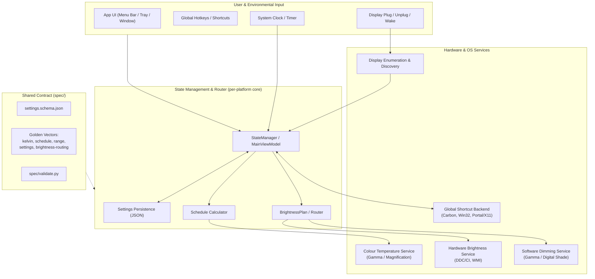

# System Architecture & Technical Specification

Moonglow is a cross-platform screen colour temperature and dual hardware/software brightness controller for macOS, Windows, and Linux.

The repository is structured as a monorepo containing three independent native implementations bound together by a shared behavioural contract and test vectors in `spec/`.

---

## 1. High-Level Architecture Diagram



---

## 2. Core Architectural Components

### 2.1 The Specification (`spec/`)
The single source of truth for configuration keys, default values, validation ranges, and mathematical conversions:
- `spec/settings.schema.json`: Strict JSON Schema defining all settings including dual-brightness toggles and recovery shortcuts.
- `spec/vectors/kelvin.json`: Golden RGB lookup curves for color temperature (900 K to 6600 K).
- `spec/vectors/schedule.json`: Golden targets for the five daily schedule phases (Night, Morning ramp, Day, Evening ramp, Night).
- `spec/vectors/temperature-range.json`: Golden snapping and range-clamping cases.
- `spec/vectors/settings.json`: Settings serialization, deserialization, and normalization vectors.
- `spec/vectors/brightness-routing.json`: Master routing vectors for dual-brightness mapping (both engines at floor 50 and floor 1, hardware-only, software-only, split mode, and mode transitions).
- `spec/validate.py`: Schema validator and vector consistency verifier.

### 2.2 Per-Platform Implementations

1. **macOS (`apps/macos`)**:
   - Written in Swift and SwiftUI.
   - Core logic in `MoonglowKit` (`MainViewModel`, `AppSettings`, `BrightnessPlan`, `ScheduleService`, `NativeBridge`).
   - App shell in `Moonglow` (`AppDelegate`, `MenuSliderRow`, `CarbonHotKeyService`).
   - Backends: Intel DDC, Apple Silicon AVService proxy, CoreGraphics gamma ramps.
   - Flavour: Standard menu bar app & App Store sandboxed prototype.

2. **Windows (`apps/windows`)**:
   - Written in C# targeting .NET 8.0 and .NET Framework 4.8 (WPF).
   - Core logic in `Moonglow.Core` (`AppSettings`, `BrightnessPlan`, `KelvinConversion`, `ScheduleCalculator`).
   - Platform services: `BrightnessService` (WMI internal panel + DDC/CI external), `ColorTemperatureService` (Magnification API + legacy GDI gamma fallback), `MonitorService`, `HotkeyService`.
   - UI: Modern tray popup (`TrayPopup.xaml`), Settings window (`MainWindow.xaml`).

3. **Linux (`apps/linux`)**:
   - Written in Rust.
   - Pure state and contract library in `moonglow-core` (`StateManager`, `AppSettings`, `brightness_plan`, `schedule`, `DisplayInfo`).
   - App crate in `moonglow`: GTK4 / libadwaita UI (`settings_ui.rs`), DDC/CI controller via `i2c-dev` (`ddc.rs`), Wayland gamma (`wlr.rs`), X11 RandR gamma (`x11.rs`), and XDG desktop portal shortcuts (`shortcuts/portal.rs`).

---

## 3. Dual-Brightness Routing Architecture

```mermaid
flowchart TD
    Input[Brightness Input: Master or Split] --> SplitCheck{Split Mode Active?}
    
    SplitCheck -- Yes --> SplitRoute[Hardware = manualHardware\nSoftware = max(manualSoftware, floor)]
    SplitCheck -- No --> EngineCheck{Available Engines}
    
    EngineCheck -- Both Usable --> UnifiedDual{Master >= 50%?}
    UnifiedDual -- Yes (50-100%) --> HwZone["Hardware = 1 + round((master - 50) * 99 / 50)\nSoftware = 100%"]
    UnifiedDual -- No (1-49%) --> SwZone["Hardware = 1% (Pinned Floor)\nSoftware = floor + round((master - 1) * (99 - floor) / 48)"]
    
    EngineCheck -- Hardware Only --> HwOnly["Hardware = master\nSoftware = 100%"]
    EngineCheck -- Software Only --> SwOnly["Hardware = Unmanaged / Released\nSoftware = max(master, floor)"]
    EngineCheck -- Neither Usable --> Idle["Hardware = Unmanaged / Released\nSoftware = 100%"]
    
    SplitRoute --> Apply[Apply to Backends]
    HwZone --> Apply
    SwZone --> Apply
    HwOnly --> Apply
    SwOnly --> Apply
    Idle --> Apply
```

### 3.1 50% Safe Floor & Recovery Shortcut
- **Safe Floor (50%)**: Software dimming does not require a recovery shortcut to operate; it is safely floored at 50% (`softwareBrightnessFloor = 50`) by default to prevent accidental black-out.
- **Deep Dimming (1–49%)**: Registering a global recovery shortcut (`restoreBrightnessShortcut`) unlocks deep dimming from 49% down to 1%.
- **Zero Data Loss (H1 Resolution)**: Settings are never mutated or forced to 100 upon shortcut absence or session lock. Output application applies the safe floor while retaining the user's saved preference.
- **Hardware Ownership Tracking (H3 Resolution)**: Physical monitor backlights are only commanded when hardware is the active route. When transitioning off hardware, hardware is gracefully released once, avoiding periodic 100% spikes on unmanaged displays.
- **Split Hotkey Cascading (M1 Resolution)**: Hotkey adjustments in split mode cascade across software and hardware boundaries smoothly.
- **Continuous Mode Switching (M2 Resolution)**: Transitioning between unified and split modes converts current light outputs continuously so screen appearance does not jump.

---

## 4. Multi-Agent Relay Protocol

In accordance with [AGENTS.md](AGENTS.md):
- `outcome.md`: Ephemeral relay baton holding findings and blockers during hand-offs. Empty (0 bytes) when all tasks and reviews pass.
- `system.md`: Living master architecture state of truth (this document).
- `README.md`: Customer-facing overview.
