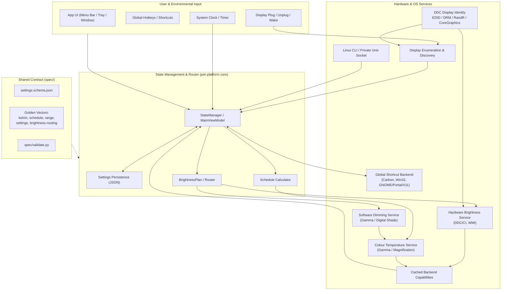
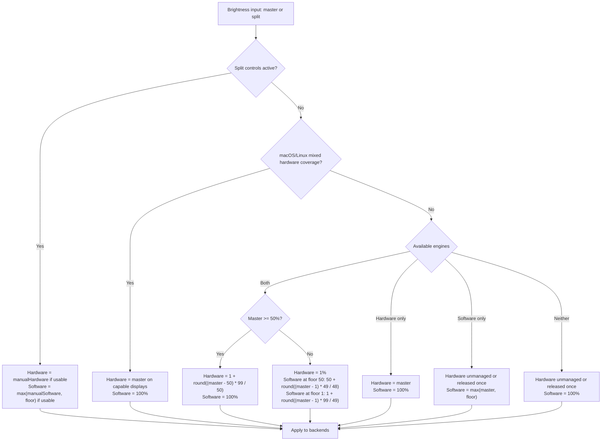

# System Architecture & Technical Specification

Moonglow is a cross-platform screen colour temperature and dual hardware/software brightness controller for macOS, Windows, and Linux.

The repository is structured as a monorepo containing three independent native implementations bound together by a shared behavioural contract and test vectors in `spec/`.

---

## 1. High-Level Architecture Diagram

---

## 2. Core Architectural Components

### 2.1 The Specification (`spec/`)
The single source of truth for configuration keys, default values, validation ranges, and mathematical conversions:
- `spec/settings.schema.json`: Strict JSON Schema defining all settings including dual-brightness toggles and recovery shortcuts.
- `spec/vectors/kelvin.json`: Golden RGB lookup curves for color temperature (900 K to 6600 K).
- `spec/vectors/schedule.json`: Golden targets for the five daily schedule phases (Night, Morning ramp, Day, Evening ramp, Night).
- `spec/vectors/temperature-range.json`: Golden snapping and range-clamping cases.
- `spec/vectors/settings.json`: Settings serialization, deserialization, and normalization vectors.
- `spec/vectors/brightness-routing.json`: Master routing vectors for dual-brightness mapping (both engines at floor 50 and floor 1, hardware-only, software-only, split mode, and mode transitions).
- `spec/validate.py`: Schema validator and vector consistency verifier.

### 2.2 Per-Platform Implementations

1. **macOS (`apps/macos`)**:
   - Written in Swift and SwiftUI.
   - Core logic in `MoonglowKit` (`MainViewModel`, `AppSettings`, `BrightnessPlan`, `ScheduleService`, `NativeBridge`).
   - App shell in `Moonglow` (`AppDelegate`, `MenuSliderRow`, `CarbonHotKeyService`).
   - Backends: Intel DDC, Apple Silicon AVService proxy, CoreGraphics gamma ramps.
   - Flavours: standard menu bar app and software-only App Sandbox prototype. Core defaults remain canonical; the sandbox shell injects neutral first-launch defaults into `SettingsStore`.
   - Hardware DDC targets the current primary external display. Intel reopens after target changes or repeated failures; Apple Silicon matches a unique external `DCPAVServiceProxy` by valid EDID vendor/product/serial before probing. Ambiguous matches fall back to software.
   - A backend publishes hardware support only after the luminance probe succeeds.

2. **Windows (`apps/windows`)**:
   - WPF app targeting .NET Framework 4.8; portable core and core tests target net48 and net8.0, and platform worker tests target net8.0.
   - Core logic in `Moonglow.Core` (`AppSettings`, `BrightnessPlan`, `KelvinConversion`, `ScheduleCalculator`).
   - Platform services: `BrightnessService` (WMI internal panel + DDC/CI external), `ColorTemperatureService` (Magnification API + legacy GDI gamma fallback), `MonitorService`, `HotkeyService`.
   - UI: tray popup (`TrayPopup.xaml`) and settings window (`MainWindow.xaml`).
   - `ColorTemperatureService` owns driver calls on a dedicated worker. A volatile cached software capability and change event notify the dispatcher without taking the driver's lock. Legacy gamma keeps temperature on capable monitors and disables uniform dimming when a monitor refuses ramps; captured original ramps are reused rather than read every frame.
   - WMI detection computes a complete snapshot before publishing under the state lock. Startup DDC probing stops once any hardware is found, hardware is disabled, or the bounded retry budget is exhausted.

3. **Linux (`apps/linux`)**:
   - Written in Rust.
   - Pure state and contract library in `moonglow-core` (`StateManager`, `AppSettings`, `brightness_plan`, `schedule`, `DisplayInfo`).
   - App crate in `moonglow`: GTK4 / libadwaita UI (`settings_ui.rs`), DDC/CI via `i2c-dev` (`ddc.rs`), Wayland gamma (`wlr.rs`), X11 RandR gamma (`x11.rs`), and GNOME, portal and X11 shortcuts.
   - DDC probing reads EDID identity from answering buses. DRM and RandR match the same identity independently of driver connector spelling. Card-qualified connector names avoid duplicate-suffix collisions; complete external coverage can be inferred only when DRM/bus counts agree, and the X11 fallback also checks the RandR external count. Disabled DRM connectors are excluded.
   - wlroots keeps successful gamma controls alive for temperature even when another output refuses control. Callback indices stay stable; software dimming requires coverage of all active outputs.
   - GTK value/range/expander updates run with handlers suppressed and no `RefCell` borrow held across signals. The native control regression runs under Xvfb in CI.
   - IPC uses a private, current-user-owned 0700 runtime directory, or a 0700 per-user temporary directory when `XDG_RUNTIME_DIR` is unset. Symlink directories and lock files are rejected; the instance lock is acquired before probing hardware.

---

## 3. Dual-Brightness Routing Architecture

### 3.1 Safety, ownership and transitions

- Software dimming is usable without a shortcut, with a 50% floor. Registering `restoreBrightnessShortcut` unlocks 1–49%. Sliders use the applicable minimum and show the applied value; the recovery action remains accessible whenever software is dimmed.
- A configured shortcut that is still registering, or a temporary loss of a recovery binding, does not erase saved deep settings. Explicit restore is the action that writes 100 into saved brightness values.
- Hardware writes occur only while hardware is routed. Disabling a route Moonglow owned releases it once to 100%; never-owned backlights are not reset. Ownership is dropped when support disappears.
- macOS and Linux preserve hardware control on capable displays in mixed setups. Their unified mixed route drives those backlights directly and leaves gamma brightness at 100; split Digital Shade can dim all gamma-capable displays. macOS hardware is limited to the primary external display. Windows retains complete-coverage hardware routing because Magnification is desktop-wide. This follows H2's minimum regression-preserving option; full per-display gamma routing is not implemented.
- Opening split controls captures the current routed hardware/software values. Returning to a single slider uses the effective level `hardware × software / 100`; integer rounding can shift that level by approximately one percentage point. Engine/floor changes re-express the last applied output when possible, subject to the new safety floor and retention of pending deep preferences.
- Split hotkeys brighten software before hardware, and dim hardware before software. Each step respects the software floor.
- Linux's optional `restoreBrightnessBoundExternally` flag acknowledges an external compositor binding after a successful IPC recovery command. It is effective only when the shortcut worker confirms that no application shortcut backend exists; returning to an available backend restores the normal registration requirement.
- The shared vectors pin floor endpoints, independent split levels, mode/engine/floor conversions, recovery duplicate priority, invalid shortcuts and clearing. `spec/validate.py` checks the numeric outputs and transitions, and every platform consumes the vectors.

### 3.2 Verification

macOS CI builds/tests the standard and sandbox flavours. Linux CI tests the complete workspace,
runs the native GTK regression under Xvfb, checks Clippy with warnings denied, and verifies formatting.
Windows CI builds the net48 WPF app and runs core/platform tests. The portable platform tests source-link
the production display workers and replace only native WMI/gamma boundaries.

The follow-up audit of `41810a0` is recorded in [`docs/fable-review-verification.md`](docs/fable-review-verification.md).

---

## 4. Multi-Agent Relay Protocol

In accordance with [AGENTS.md](AGENTS.md):
- `outcome.md`: Ephemeral relay baton holding findings and blockers during hand-offs. Empty (0 bytes) when all tasks and reviews pass.
- `system.md`: Living master architecture state of truth (this document).
- `README.md`: Customer-facing overview.
